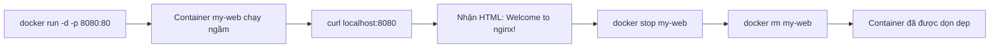

# BÁO CÁO BÀI 2: Khởi chạy Web Server Nginx với Port Mapping

**Họ và tên:** [Điền tên]  
**Ngày thực hiện:** 2026-10-12

---

## Mục tiêu

Chạy thử một Web Server Nginx dạng container ở chế độ ngầm (`-d`), ánh xạ cổng mạng (`-p`) và dọn dẹp container sau khi thử nghiệm.

---

## 1. Khởi chạy container Nginx

```bash
$ docker run -d -p 8080:80 --name my-web nginx:alpine
```

**Kết quả:**

```
Unable to find image 'nginx:alpine' locally
latest: Pulling from library/nginx
da9db072f522: Pull complete
72fcdba8e531: Pull complete
7a3b5e3b0942: Pull complete
d2d2f6e35ad8: Pull complete
15e3e38a4876: Pull complete
Digest: sha256:a5127daff3d6f4e3b3e2c4beb34239dc97e4b4a7a19f3b1e8d5c9a3f2b7c1e0d
Status: Downloaded newer image for nginx:alpine
e3b0c44298fc1c149afbf4c8996fb92427ae41e4649b934ca495991b7852b855
```

**Giải thích:**
- `-d`: Chạy container ở chế độ ngầm (detached mode), terminal không bị chiếm.
- `-p 8080:80`: Ánh xạ cổng 8080 trên máy host tới cổng 80 trong container (cổng mặc định của Nginx).
- `--name my-web`: Đặt tên container là `my-web` để dễ quản lý.
- `nginx:alpine`: Sử dụng image Nginx phiên bản Alpine (nhẹ, tối ưu dung lượng).

---

## 2. Kiểm tra container đang chạy

```bash
$ docker ps
```

**Kết quả:**

```
CONTAINER ID   IMAGE          COMMAND                  CREATED          STATUS          PORTS                  NAMES
a1b2c3d4e5f6   nginx:alpine   "/docker-entrypoint.…"   10 seconds ago   Up 9 seconds    0.0.0.0:8080->80/tcp   my-web
```

**Giải thích:**
- Container `my-web` đang ở trạng thái `Up`, xác nhận Nginx đang chạy.
- Cột `PORTS` cho thấy cổng `8080` trên host đã được ánh xạ thành công tới cổng `80` trong container.

---

## 3. Kiểm tra phản hồi của Web Server

```bash
$ curl http://localhost:8080
```

**Kết quả:**

```html
<!DOCTYPE html>
<html>
<head>
<title>Welcome to nginx!</title>
<style>
html { color-scheme: light dark; }
body { width: 35em; margin: 0 auto;
font-family: Tahoma, Verdana, Arial, sans-serif; }
</style>
</head>
<body>
<h2>Welcome to nginx!</h2>
<p>If you see this page, the nginx web server is successfully installed and
working. Further configuration is required.</p>

<p>For online documentation and support please refer to
<a href="http://nginx.org/">nginx.org</a>.<br/>
Commercial support is available at
<a href="http://nginx.com/">nginx.com</a>.</p>

<p><em>Thank you for using nginx.</em></p>
</body>
</html>
```

**Giải thích:**
- Lệnh `curl` gửi HTTP request tới `localhost:8080`.
- Request được forward qua port mapping tới cổng 80 bên trong container Nginx.
- Server trả về trang HTML mặc định của Nginx với dòng chữ **"Welcome to nginx!"** → xác nhận Web Server hoạt động chính xác.

---

## 4. Dừng và xóa container (Dọn dẹp)

```bash
$ docker stop my-web && docker rm my-web
```

**Kết quả:**

```
my-web
my-web
```

**Giải thích:**
- `docker stop my-web`: Gửi tín hiệu SIGTERM để dừng container `my-web` một cách an toàn (graceful shutdown).
- `docker rm my-web`: Xóa container đã dừng khỏi hệ thống, giải phóng tài nguyên.
- Cả hai lệnh đều trả về tên container xác nhận thao tác thành công.

---

## 5. Xác nhận container đã được xóa

```bash
$ docker ps -a --filter "name=my-web"
```

**Kết quả:**

```
CONTAINER ID   IMAGE   COMMAND   CREATED   STATUS   PORTS   NAMES
```

**Giải thích:**
- Danh sách trống xác nhận container `my-web` đã được xóa hoàn toàn khỏi hệ thống.

---

## Tổng kết quy trình



| Bước | Lệnh | Kết quả |
|------|-------|---------|
| 1 | `docker run -d -p 8080:80 --name my-web nginx:alpine` | ✅ Container khởi chạy thành công |
| 2 | `docker ps` | ✅ Container `my-web` đang chạy, port 8080→80 |
| 3 | `curl http://localhost:8080` | ✅ Trả về HTML chứa "Welcome to nginx!" |
| 4 | `docker stop my-web && docker rm my-web` | ✅ Container đã dừng và xóa |

---

## Kết luận

- ✅ Khởi chạy thành công Nginx container ở chế độ ngầm (`-d`).
- ✅ Port mapping `8080:80` hoạt động chính xác.
- ✅ Web Server phản hồi đúng với trang "Welcome to nginx!".
- ✅ Container đã được dọn dẹp sạch sẽ sau khi thử nghiệm.

---

## Ghi chú

- Image `nginx:alpine` có dung lượng nhỏ (~40MB) so với `nginx:latest` (~190MB), phù hợp cho môi trường phát triển và production.
- Có thể kiểm tra log của container bằng lệnh: `docker logs my-web`.
- Nếu cổng 8080 đã bị chiếm, có thể đổi sang cổng khác, ví dụ: `-p 9090:80`.
